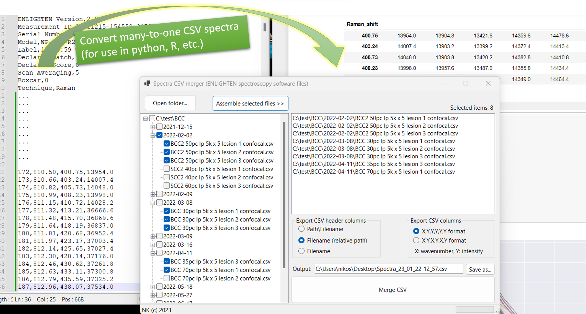
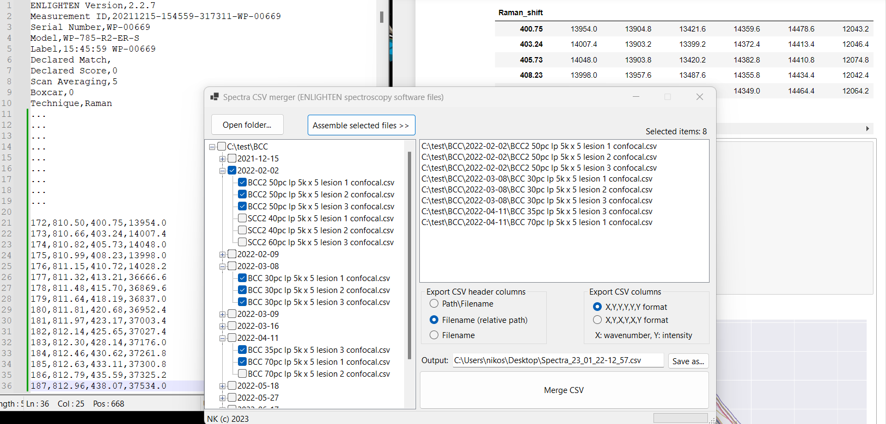

# SpecCSVMerger — Spectra CSV Merger for ENLIGHTEN files

A small Windows tool that merges many spectrum CSV files exported by
[ENLIGHTEN](https://github.com/WasatchPhotonics/ENLIGHTEN) (the spectroscopy
software for Wasatch Photonics spectrometers) into **one tidy CSV table**, ready for
analysis in Python, R, MATLAB, Origin, Excel, etc.



ENLIGHTEN saves each measurement as its own CSV file, with a block of metadata lines
(version, serial number, model, integration settings, …) followed by the
`Pixel, Wavelength, Wavenumber, Processed, …` data columns. When you have dozens or
hundreds of spectra spread over dated sub-folders, collecting them by hand is slow and
error-prone. SpecCSVMerger does it in a few clicks.

## Features

- Browse a folder tree; only **ENLIGHTEN CSV files** are listed (files whose first line
  starts with `ENLIGHTEN`), so other CSVs don't clutter the view.
- Tick whole folders or individual files, from any number of sub-folders.
- Two output layouts:
  - **X,Y,Y,Y…** — one wavenumber column followed by one intensity column per spectrum
  - **X,Y,X,Y…** — a wavenumber/intensity pair for every spectrum
- Three choices for the column headers: full path, file name with its parent folder
  (e.g. the measurement date), or file name only.
- Remembers your last choices and output folder. The default output file is
  `Spectra_yy_MM_dd-HH_mm.csv` on the Desktop (double-click the output box to reset it).

X = Raman shift / wavenumber (cm⁻¹, ENLIGHTEN `Wavenumber` column),
Y = intensity (ENLIGHTEN `Processed` column).

## Download

Get the latest `SpectraMerge.exe` from the [**Releases**](../../releases) page.

Requirements: Windows 10 or 11 (64-bit). Release builds are self-contained, so nothing
else needs to be installed. (If you build it yourself as a framework-dependent app, you
will need the [.NET 10 Desktop Runtime](https://dotnet.microsoft.com/download/dotnet/10.0).)

## How to use



1. Click **Open folder…** and choose the folder that holds your spectra
   (sub-folders are included).
2. Expand the tree and tick the folders and/or files you want.
3. Click **Assemble selected files >>**. The files to be merged appear in the list on
   the right, with a count of selected items.
4. Choose the header style and the column layout.
5. Check the **Output** path (or use **Save as…**), then click **Merge CSV**.

### Example output (X,Y,Y,Y layout, "Filename (relative path)" headers)

```text
Raman Shift,sample 1.csv (2022-02-02),sample 2.csv (2022-02-02),sample 3.csv (2022-03-08),...
400.75,13954.0,13904.8,...
403.24,14007.4,13903.2,...
405.73,14048.0,13903.8,...
```

### Loading the merged file

Python (pandas):

```python
import pandas as pd

df = pd.read_csv("Spectra_23_01_22-12_57.csv", index_col=0)   # index = Raman shift
df.plot(legend=False)
```

R:

```r
df <- read.csv("Spectra_23_01_22-12_57.csv", check.names = FALSE)
matplot(df[[1]], as.matrix(df[-1]), type = "l", lty = 1,
        xlab = "Raman shift (cm-1)", ylab = "Intensity")
```

## Notes and limitations

- In the **X,Y,Y,Y** layout only the wavenumber axis of the *first* file is kept, so all
  selected spectra should share the same axis (same spectrometer and calibration).
  Use the **X,Y,X,Y** layout if they don't.
- If the files have different numbers of points, the output stops at the shortest one.
- Intensities are taken from ENLIGHTEN's `Processed` column.
- The first header cell is always `Raman Shift`, whatever the measurement technique.

## Building from source

Requirements: Windows, and either Visual Studio 2026 with the *.NET desktop development*
workload or the [.NET 10 SDK](https://dotnet.microsoft.com/download/dotnet/10.0).

```powershell
git clone https://github.com/<your-username>/SpecCSVMerger.git
cd SpecCSVMerger
dotnet build -c Release
```

or open `SpectraMerge.sln` in Visual Studio and press F5.

To make a single, self-contained `.exe` for a release:

```powershell
dotnet publish SpectraMerge.vbproj -c Release -r win-x64 --self-contained true `
  -p:PublishSingleFile=true -p:IncludeNativeLibrariesForSelfExtract=true -o publish
```

The program ends up in `publish\SpectraMerge.exe`. To publish it on GitHub, go to
**Releases → Draft a new release**, create a tag such as `v1.2.0`, and attach the
`.exe` (or a zip of it).

The project is written in Visual Basic .NET (Windows Forms) and uses
[CsvHelper](https://joshclose.github.io/CsvHelper/) (restored automatically from NuGet).

## Changelog

- **1.2.0** — Moved to .NET 10 (LTS). Empty CSV files no longer crash the folder view;
  input files are closed (no longer stay locked) after merging; `.CSV` extensions in
  upper case are recognised; removed unused code.
- **1.1.0** (2023) — First release (.NET 6).

## Citing

If this tool helps your research, please cite it — see [`CITATION.cff`](CITATION.cff),
or use the **Cite this repository** button on GitHub.

## License

[MIT](LICENSE) © 2026 Nikolaos Kourkoumelis, University of Ioannina, Greece —
<https://myweb.uoi.gr/nkourkou/>

ENLIGHTEN and Wasatch Photonics are trademarks of their respective owner. This project
is independent and not affiliated with or endorsed by Wasatch Photonics.
